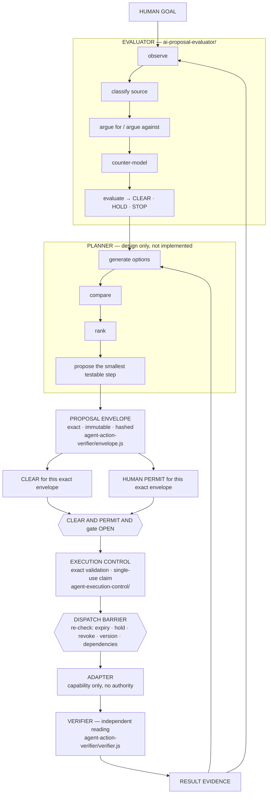
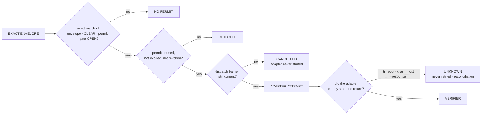
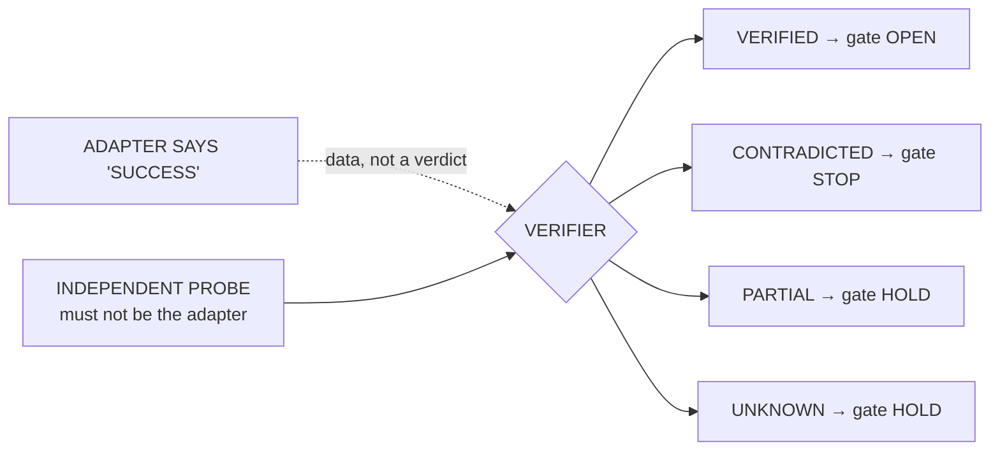
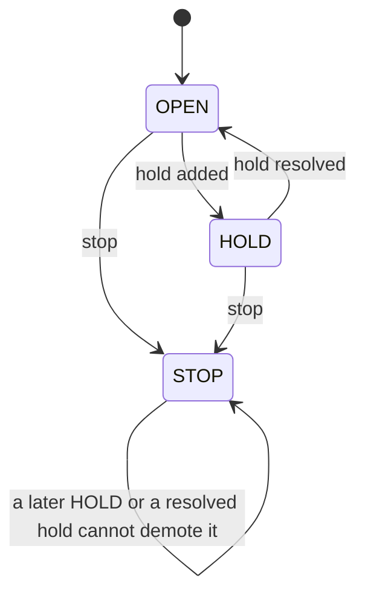

# Architecture — authority-separated execution for AI agents

How the tools in this repository fit together. One rule runs through all of it: **thinking, proposing, permitting, executing and verifying are five different things, and none of them can create another.**

Each box names the folder that implements it. Where something is designed but not implemented, the diagram says so.

## 1. The loop

The permit and the evaluator's CLEAR meet only at the join. The human permit does not feed the evaluator's reasoning, and the evaluator's CLEAR is not a permit.

Arrows back to *observe* and *generate* carry evidence only. **A new action needs a new envelope, a new CLEAR and a new permit.** Nothing in the loop re-executes on its own.

## 2. Every way to not act

| Outcome | Where | Meaning |
|---|---|---|
| `NO PERMIT` | permit issue | evaluator not CLEAR, gate not OPEN, or any field of the envelope differs |
| `REJECTED` | claim | the permit is used, expired or revoked; one permit gives exactly one claim |
| `CANCELLED` | dispatch barrier | something changed between claim and dispatch; the adapter was not called |
| `UNKNOWN` | after the attempt | the outcome cannot be told; never retried; a reconciler moves abandoned claims here |

## 3. What the verifier's answer does

No verdict authorises a retry (`retryAuthorized` is always `false`). A retry is a new action and needs a new permit.

## 4. Gate states

`STOP > HOLD > OPEN`. `STOP` is terminal. The defect where a later `HOLD` could demote a `STOP` is recorded in [`agent-execution-control/`](agent-execution-control/README.md#defect-history).

## The envelope: what "exact" covers

The proposal envelope names the action, object, target, scope, quantity, permissions and side effects. These seven fields are material, and a change in any of them stops the action. Two fields are explicit metadata (`requestedBy`, `traceId`). **Every other field — dependencies, expected effect, reversibility or anything new — is unmodelled, and any difference in it also stops the action** ([`agent-action-verifier/`](agent-action-verifier/README.md)). Execution control also binds the permit to the version and the dependency digest ([`agent-execution-control/`](agent-execution-control/README.md)).

## What is and is not built

| Part | Status | Folder |
|---|---|---|
| Evaluator | implemented, 247 tests | `ai-proposal-evaluator/` |
| Planner | **design only** | — |
| Proposal envelope check | implemented, in-process | `agent-action-verifier/` |
| Permit, claim, dispatch barrier, gate states, reconciler | implemented, PostgreSQL-enforced | `agent-execution-control/` |
| Verifier logic | implemented, in-process; **has no probe of its own** | `agent-action-verifier/` |
| Adapter | **not implemented**; no real external action has been run | — |
| The two implemented halves wired together | **not done** | — |

Small gates in front of individual actions: `payload-policy-validator/` (is this payload safe to run), `batch-file-gateway/` (isolate, scan, write once), `status-flow-validator/` (did the request walk its status chain in order).
